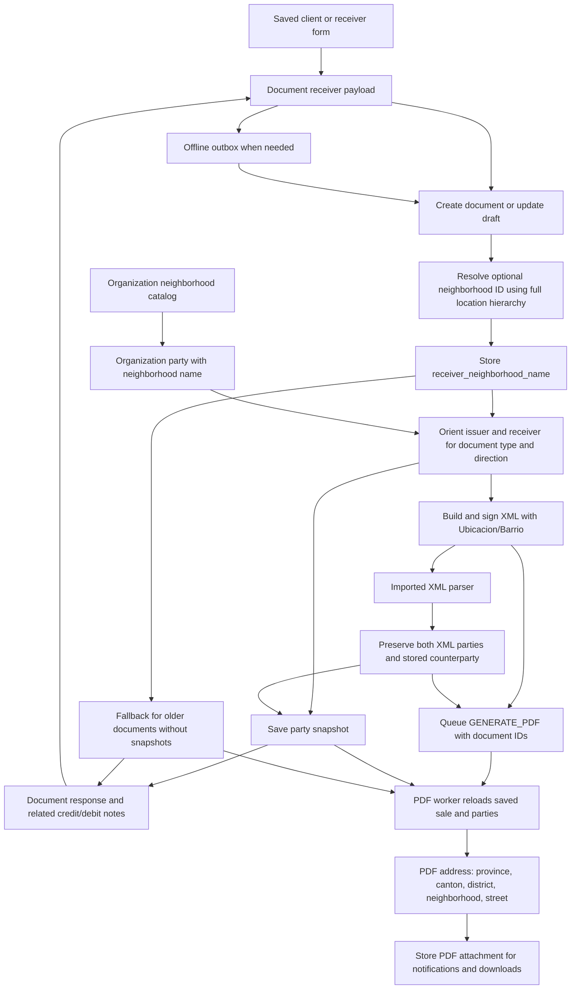

# Document address and neighborhood flow

Audited on 14 October 2026. The missing links were receiver selection/editing in checkout and the document PDF projection. Storage, fiscal XML, XML imports and party snapshots already carry `neighborhood_name`.

## Boundaries and preservation

| Boundary | Behavior and source |
| --- | --- |
| Saved client → checkout | `fe/pos-system/src/lib/documentReceiver.ts` retains the selected neighborhood ID/name even when the receiver form is never opened. |
| Receiver edits | `ClientDrawerForm.tsx`, `AddressSection.tsx` and `LocationSelect.tsx` retain the name on contact/address edits, select existing names from the catalog, and clear stale neighborhoods when the geographic hierarchy changes. |
| Offline queue → API | `pendingSalesSync.ts` replays the complete persisted payload. Name resolution happens on the server so offline capture needs no catalog request at submission time. |
| API create/update → storage | `resolve_document_neighborhoods` runs in both `SaleService` commands before `apply_dto_to_sale`. The optional input ID is resolved by country + province + canton + district + neighborhood; an invalid combination returns 422 before persistence/signing. |
| Canonical address | `ResidenceDTO.neighborhood_name` is the stored/fiscal value. The optional request-only ID is excluded from serialized snapshots and responses. Existing names from documents and imports need no lookup and remain unchanged. |
| Organization | `OrganizationAggregateRepository` resolves the organization’s saved neighborhood ID; `build_organization_party` carries the name into XML and snapshots. |
| ORM → document | `apply_customer_to_sale` and `build_customer_dto` round-trip `Sale.receiver_neighborhood_name`. |
| Purchase/received orientation | `document_parties` changes which party is issuer/receptor while preserving each party’s complete residence. |
| XML generation | The issuer/receptor mappers place the canonical name in `Ubicacion.Barrio`. Foreign identification type 05 keeps its foreign address instead of the local hierarchy. |
| XML import | `HaciendaXmlParser` retains the original XML `Barrio`; `DocumentImportWorker` keeps both original parties in `party_snapshot` and the correct counterparty in flattened storage for issued/received documents. Imported signed XML is preserved. |
| Async PDF handoff | `GENERATE_PDF` carries organization/document/sale IDs and clave. The PDF worker reloads the saved Sale and party snapshot; it does not rely on address fields being copied into event payloads. Downloads and notifications use the generated attachment. |
| Responses and related notes | `SaleService._to_response` and financial credit-note creation preserve neighborhood names; adding province/canton/district display names does not remove them. |
| PDF generation/regeneration | `PdfPipeline` includes neighborhoods from stored receivers, the organization catalog and snapshots. Enrichment uses a copy of the snapshot. Both template addresses put neighborhood between district and street address. |

## Verification

- 623 frontend tests pass, including receiver form round trips, saved-client checkout, existing document names, related credit notes and offline payload replay. Style checks, TypeScript checks and production build pass.
- 69 PDF tests and 19 subtests pass. The flow test follows a selected neighborhood through lookup, ORM storage, XML mapping, party snapshot, public response and PDF HTML for invoices, received invoices, debit/credit notes, tickets, purchase invoices in both directions and export invoices.
- 91 shared tests and 13 subtests pass; two pre-existing tests remain skipped. Resolution tests check the full geographic hierarchy, stable canonical names and invalid selections.
- 65 sales API tests and four subtests pass, covering the surrounding creation, idempotency, fiscal calculation and organization-profile behavior.
- 12 XML-import tests and two subtests pass, including preservation of both XML neighborhoods and the correct flattened counterparty for issued/received imports.
- Rendered ordinary, long-text, purchase, absent-recipient and multipage PDFs include the neighborhood without breaking shared card heights, wrapped value alignment or page counters.

Existing stored PDFs are not rewritten by deployment. The improved address appears when a PDF is generated or regenerated. No invoice was submitted, no existing signed XML was changed, and no organization/customer address was edited during this audit.

## Release

- Sales/PDF backend: `7c70584`, [deployment](https://github.com/chepelcr/tsuru-sales-be/actions/runs/38631478846).
- Checkout frontend: `b0e4f26`, [deployment](https://github.com/chepelcr/tsuru-pos-system/actions/runs/38632162226).
